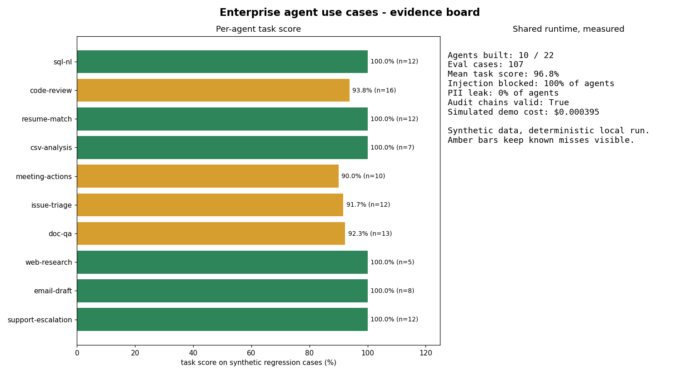
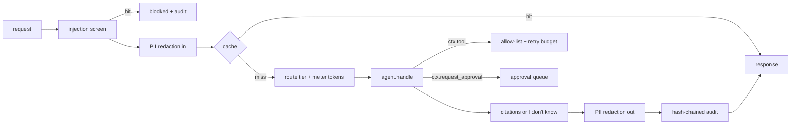

# Enterprise agent use cases on one governed runtime

**Recruiter summary.** Twenty-two business agents (SQL questions, code review, resume matching, document Q&A, invoice extraction and more) are being built here, all running through one shared runtime. That runtime screens for prompt injection, removes personal data, limits tools, routes and caches requests, budgets retries, enforces citations, waits for a human before risky actions, and writes a tamper-evident audit log. Everything runs offline with deterministic local logic, and every number below comes from a real run on synthetic data.

<!-- BEGIN:headline -->
| What | Measured (synthetic data, deterministic local run) |
|---|---|
| Agents built | 10 of 22 (batches 2 of 5) |
| Task eval cases | 107, mean task score 96.8% |
| Planted prompt injection blocked | 100% of agents |
| Planted email leaked to output | 0% of agents |
| Audit chains valid | True |
| Demo run, simulated cost (unit prices, not real spend) | $0.000395 |
| Tests | 102 |
<!-- END:headline -->



## Agents

Each agent has its own page with level, tech, industry, tags, run command, real sample output, measured eval numbers and the guardrails it uses. The same fields are exported to [`catalog/agents.json`](catalog/agents.json) for the portfolio catalog site.

<!-- BEGIN:agents -->
| # | Agent | Level | Industry | Tech | Task score (cases) |
|---|---|---|---|---|---|
| 1 | [SQL in plain English](docs/agents/sql-nl.md) | Intermediate | Analytics | SQLite + template planner | 100.0% (12) |
| 2 | [Code review](docs/agents/code-review.md) | Intermediate | Software engineering | Python AST rules | 93.8% (16) |
| 3 | [Resume parsing and matching](docs/agents/resume-match.md) | Intermediate | HR and recruiting | Rule parser + skill-coverage scorer | 100.0% (12) |
| 4 | [CSV data analysis](docs/agents/csv-analysis.md) | Beginner | Retail | Python csv + statistics | 100.0% (7) |
| 5 | [Meeting notes to action items](docs/agents/meeting-actions.md) | Beginner | Productivity | Pattern extractor | 90.0% (10) |
| 6 | [GitHub issue triage](docs/agents/issue-triage.md) | Beginner | Software engineering | Keyword classifier + Jaccard dedupe | 91.7% (12) |
| 7 | [Document Q&A with citations](docs/agents/doc-qa.md) | Intermediate | Enterprise knowledge | BM25 retrieval + citation check | 92.3% (13) |
| 8 | [Web research report (offline corpus)](docs/agents/web-research.md) | Advanced | Research and strategy | Planner + BM25 + source screening | 100.0% (5) |
| 9 | [Email drafting with human sign-off](docs/agents/email-draft.md) | Beginner | Sales and customer success | Templates + wording rules | 100.0% (8) |
| 10 | [Support with escalation](docs/agents/support-escalation.md) | Intermediate | Customer service | Intent rules + help-center lookup | 100.0% (12) |
<!-- END:agents -->

## Purpose and who it is for

- **Hiring teams (AI Engineer, Forward Deployed Engineer):** one repo that shows breadth across use cases and depth in the shared controls that make agents safe to ship.
- **Enterprise buyers and partner teams:** reference builds on synthetic data showing how a single governed layer is reused across departments, instead of each agent re-inventing safety.
- **Adopters:** a small, dependency-free runtime you can read in an afternoon and copy. See [docs/implementation-guide.md](docs/implementation-guide.md).

## Architecture



More detail: [docs/architecture.md](docs/architecture.md) and [docs/how-it-works.md](docs/how-it-works.md).

## How to run (offline, no keys, nothing billable)

```bash
python -m venv .venv && . .venv/bin/activate
pip install -e ".[dev]"
entagents list                      # all agents
entagents run sql-nl                # demo input
entagents run sql-nl --input '{"question": "Revenue in the west region"}'
entagents eval --out results/results.json
pytest -q && python scripts/count_tests.py
python scripts/render_docs.py       # regenerate agent pages, catalog JSON and the tables above
```

Test count: <!-- BEGIN:tests -->
**102 tests**
<!-- END:tests -->

There is no cloud path. The "model tiers" are deterministic local functions; the cost line uses made-up unit prices to show the accounting and is labelled simulated.

## Guardrails and security controls

Shared by every agent (details in [docs/guardrails.md](docs/guardrails.md), threats in [docs/threat-model.md](docs/threat-model.md)):

| Control | Where | Proof |
|---|---|---|
| Prompt-injection screen on every input string | `framework/guards.py` | planted injection blocked for each agent |
| PII redaction in and out (email, phone, SSN, Luhn-checked cards) | `framework/guards.py` | planted email never reaches output |
| Tool allow-list per agent; risky tools only via approval | `framework/runtime.py` | `test_runtime_pipeline` |
| Model-tier routing, LRU cache, retry budget, token meter | `framework/controls.py` | framework tests |
| Citation enforcement and "I don't know" | `framework/grounding.py` | abstention cases in evals |
| Human approval with a named approver | `framework/approval.py` | resume shortlist test |
| Hash-chained audit log, tamper detection | `framework/audit.py` | `test_audit_chain_detects_tamper` |

## Limitations and known failures

Deterministic rules stand in for models, so coverage is narrow by design. Known misses are kept as tests and visible in the scores (for example aliasing `eval` slips past the code reviewer, and passive-voice actions lose their owner). Full list: [docs/limitations.md](docs/limitations.md).

## Built vs planned

| Item | Status |
|---|---|
| Shared runtime (guards, controls, grounding, approval, audit, evals) | Built |
| Batch 1: SQL in plain English, code review, resume matching, CSV analysis, meeting actions | Built |
| Batch 2: issue triage, document Q&A, web research (offline), email drafting, support escalation | Built |
| Batch 3: unit test generator, documentation writer, news briefing, travel planner, recipe recommendation | Planned |
| Batch 4: stock research (simulated), contract clauses, invoice extraction, policy compliance, incident summary | Planned |
| Batch 5: competitive analysis, multi-agent debate with judge | Planned |
| Catalog metadata export (`catalog/agents.json`) | Built |
| Optional local LLM backend behind the same interface | Planned |
| Cloud deployment | Not planned (offline by design) |

## Docs

[Purpose](docs/purpose.md) · [Architecture](docs/architecture.md) · [How it works](docs/how-it-works.md) · [Code and output](docs/code-and-output.md) · [Running](docs/running.md) · [Guardrails](docs/guardrails.md) · [Limitations](docs/limitations.md) · [Threat model](docs/threat-model.md) · [Implementation guide](docs/implementation-guide.md) · [Interview points](docs/interview-points.md) · [ADRs](docs/adr/)

## Related repos

- [Jagadish-pii-guard](https://github.com/jagadishmazure-jpg/Jagadish-pii-guard): full PII detection and pseudonymisation; this repo carries a small rewrite of the same idea.
- [Jagadish-ai-system-design-at-scale](https://github.com/jagadishmazure-jpg/Jagadish-ai-system-design-at-scale): routing, caching, retry budgets and hallucination controls in depth.
- [Jagadish-recruiting-fairness-agents](https://github.com/jagadishmazure-jpg/Jagadish-recruiting-fairness-agents): fairness measurement for the resume-matching use case.
- [Jagadish-agent-identity-security](https://github.com/jagadishmazure-jpg/Jagadish-agent-identity-security): agent identity and least privilege.
- [Jagadish-agentic-ai-model-risk](https://github.com/jagadishmazure-jpg/Jagadish-agentic-ai-model-risk): model-risk governance for agents.

## License

MIT. All companies, people and figures in data are fictional or synthetic.
