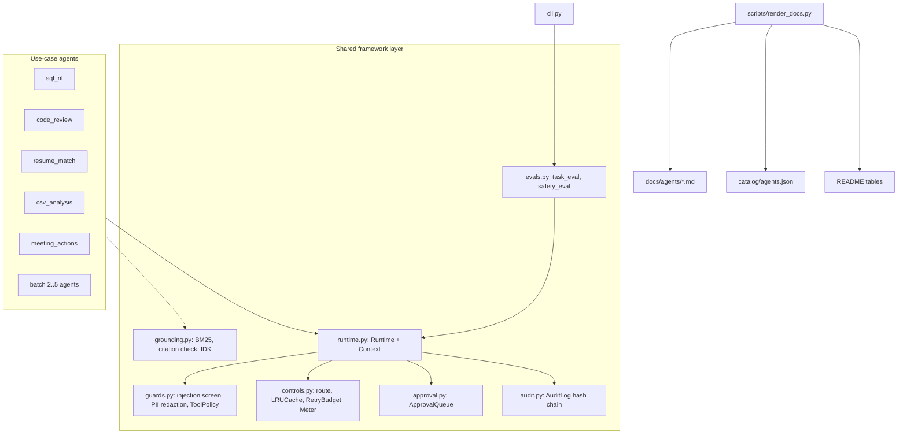

# Architecture

Design rules:
- **Agents never touch the outside world directly.** They call `ctx.tool(name, fn)`, which checks the allow-list and wraps the call in the retry budget, or `ctx.request_approval(action, detail)` for risky steps.
- **The runtime owns safety.** An agent cannot skip injection screening, redaction or audit because it never sees the raw request.
- **Metadata is code.** Each agent's `META` drives its doc page and its catalog card, so they cannot drift.

Decisions: [ADR 0001](adr/0001-shared-runtime.md), [ADR 0002](adr/0002-deterministic-agents.md).
