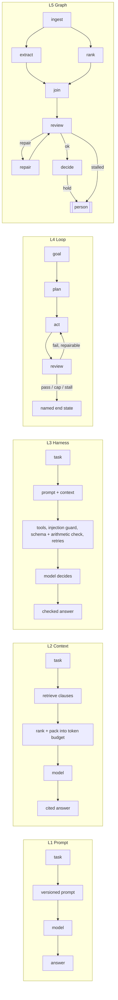
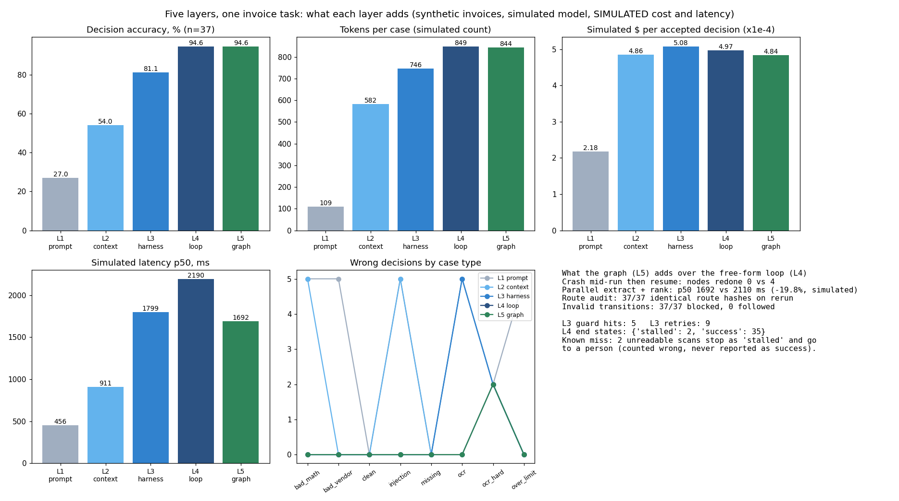

# Five layers of agent engineering

> Synthetic invoices, a simulated (rule-based) model, and **simulated** token prices and latency.
> Every number below comes from `python -m entagents.fourlayers bench` (n = 37 cases, deterministic).
> Branch name is `grokbot/four-layers`; graph engineering was added as a fifth layer during the build.

## Recruiter summary

One invoice-approval task is solved five times, each time adding one layer of engineering:
a better prompt, then curated context, then a checked execution harness, then a bounded
review loop, then an explicit state graph. Accuracy climbs from 27.0% to 94.6% on 37 synthetic
invoices. The graph matches the loop's accuracy while cutting simulated p50 latency 19.8% through
parallel branches, redoing 0 nodes after a mid-run crash (the loop redoes 4) and blocking 37 of 37
invalid route attempts.

## The five layers in one picture



| Layer | What it is | What good looks like (our checklist) |
|---|---|---|
| L1 Prompt | Clear instructions for one model call | Prompts stored as versioned files with a hash; a golden set gates every change on schema, drift and cost |
| L2 Context | Choosing what the model sees | Retrieval, ranking and a hard token budget; measure accuracy against tokens; cite the clause used |
| L3 Harness | The execution layer around the model | Deterministic checks first (schema, arithmetic, allow-lists), injection guard, bounded retries, traces, eval gate in CI |
| L4 Loop | Plan, act, review, retry or stop | Turn, cost and deadline caps; a stall detector; named end states; errors and exhausted budgets never count as success; cost per accepted change |
| L5 Graph | The workflow as an explicit state graph | Typed shared state, declared edges, conditional routing that cannot leave its allowed set, parallel fan-out/fan-in, checkpoint after every node, human interrupt nodes, subgraphs, a replayable route log |

## Measured results (simulated model and meters, n = 37)

| Layer | Accuracy | Clause cited correctly | Output checked | Tokens/case | Sim $/case | Sim $/accepted decision | Sim p50 ms | Calls/case |
|---|---|---|---|---|---|---|---|---|
| L1 prompt | 27.0% | 0.0% | 0% | 109 | 0.0000589 | 0.000218 | 456 | 1.00 |
| L2 context | 54.1% | 54.1% | 0% | 582 | 0.0002625 | 0.000486 | 911 | 2.00 |
| L3 harness | 81.1% | 81.1% | 100% | 747 | 0.0004120 | 0.000508 | 1,799 | 3.00 |
| L4 loop | 94.6% | 94.6% | 100% | 849 | 0.0004702 | 0.000497 | 2,190 | 4.38 |
| L5 graph | 94.6% | 94.6% | 100% | 844 | 0.0004574 | 0.000484 | 1,692 | 4.43 |

Wrong decisions by case type (5 cases each, 2 for `ocr_hard`):

| Case type | L1 | L2 | L3 | L4 | L5 | Fixed by |
|---|---|---|---|---|---|---|
| over_limit | 5 | 0 | 0 | 0 | 0 | L2: threshold clause retrieved |
| bad_vendor | 5 | 0 | 0 | 0 | 0 | L2: vendor-list clause retrieved |
| injection | 5 | 5 | 0 | 0 | 0 | L3: injection guard |
| bad_math | 5 | 5 | 0 | 0 | 0 | L3: arithmetic tool |
| ocr (scan errors in labels) | 5 | 5 | 5 | 0 | 0 | L4: reviewer + repair turn |
| ocr_hard (unreadable) | 2 | 2 | 2 | 2 | 2 | **Known miss**: stops as `stalled` and goes to a person |
| clean, missing | 0 | 0 | 0 | 0 | 0 | |

What the graph adds over the free-form loop:

| Measure | Graph (L5) | Free-form loop (L4) |
|---|---|---|
| Nodes redone after a crash in `review` | 0 | 4 (no checkpoint, starts over) |
| Simulated p50 latency (extract and rank in parallel) | 1,692 ms | 2,110 ms (same steps in sequence), 19.8% saved |
| Real wall clock, two 50 ms branches | about 50 ms (varies by machine) | about 100 ms in sequence |
| Route audit: identical route hash on rerun | 37 / 37 | no route log |
| Invalid transitions attempted / blocked / followed | 37 / 37 / 0 | not applicable |

Other measured counts: L3 guard hits 5, L3 retries 9 (a simulated flaky vendor lookup on every 4th case),
L4 end states `success` 35 and `stalled` 2. Board: [`results/layers_board.png`](../results/layers_board.png).



## How the layers are built here

| Piece | File |
|---|---|
| Synthetic task, policy corpus, gold labels | [`fourlayers/task.py`](../src/entagents/fourlayers/task.py) |
| Simulated meters (tokens, $, ms) | [`fourlayers/sim.py`](../src/entagents/fourlayers/sim.py) |
| L1 to L5 implementations | [`fourlayers/layers.py`](../src/entagents/fourlayers/layers.py) |
| Prompt registry (versioned JSON + hash) | [`fourlayers/registry.py`](../src/entagents/fourlayers/registry.py), [`prompts/`](../src/entagents/fourlayers/prompts/) |
| Golden regression gate | [`fourlayers/gate.py`](../src/entagents/fourlayers/gate.py), [`golden/invoice_policy.json`](../src/entagents/fourlayers/golden/invoice_policy.json) |
| LoopPolicy | [`fourlayers/loop_policy.py`](../src/entagents/fourlayers/loop_policy.py) |
| Graph runner | [`fourlayers/graph.py`](../src/entagents/fourlayers/graph.py) |
| Benchmark | [`fourlayers/bench.py`](../src/entagents/fourlayers/bench.py) |
| Tests (66) | [`tests/test_fourlayers.py`](../tests/test_fourlayers.py) |

### LoopPolicy in short

```python
pol = LoopPolicy(max_turns=4, max_cost_usd=0.002, deadline_s=30, stall_window=2)
pol.start()
stop = pol.step("repair", "ocr-labels", new_text, cost_so_far)  # None, or End.EXHAUSTED / End.STALLED
end = pol.finish(verified=True)            # End.SUCCESS only when verified and no error
cost_per_accepted_change(total_cost, accepted)   # None when nothing was accepted
```

Rules: a cap or a stall ends the loop as `exhausted` or `stalled`; an error or a failed check ends it as
`blocked`; `no-op` means nothing needed changing. Only a verified result is `success`.

### Prompt registry and golden gate

Prompts live in `prompts/<id>.v<N>.json` with a changelog and required output keys; the registry
returns a 12-character content hash so every result can name the exact prompt. `python -m entagents.fourlayers gate`
re-runs the active version against the golden file and fails if any output breaks the schema, more than 5%
of decisions drift, or simulated cost per case rises more than 10%. Re-record on purpose with
`python -m entagents.fourlayers record` and review the diff in the PR.

## Cross-repo map: where each layer is proven

| Layer | Repos and files | Strength |
|---|---|---|
| L1 Prompt | This PR: registry + golden gate. [Jagadish-dspy-prompt-optimizer](https://github.com/jagadishmazure-jpg/Jagadish-dspy-prompt-optimizer) (`dspyopt/teleprompt.py`, `dspyopt/metrics.py`). [Jagadish-langchain-langgraph-langsmith](https://github.com/jagadishmazure-jpg/Jagadish-langchain-langgraph-langsmith) (`src/lcstack/capstone/prompts.py`). Few-shot refusal in [Jagadish-ai-system-design-at-scale](https://github.com/jagadishmazure-jpg/Jagadish-ai-system-design-at-scale) (`sysdesign/ext/hallucination.py`) | Medium (was weak before this PR) |
| L2 Context | [Jagadish-context-engineering](https://github.com/jagadishmazure-jpg/Jagadish-context-engineering) (`src/ctxeng/budget.py`, `strategies.py`, `offload.py`, `bench.py`). [Jagadish-rag-optimization](https://github.com/jagadishmazure-jpg/Jagadish-rag-optimization) (`ragopt/rerank.py`, `compress.py`, `ablation.py`). [Jagadish-agent-memory-systems](https://github.com/jagadishmazure-jpg/Jagadish-agent-memory-systems). [Jagadish-unified-retrieval-router](https://github.com/jagadishmazure-jpg/Jagadish-unified-retrieval-router). [Jagadish-token-accounting](https://github.com/jagadishmazure-jpg/Jagadish-token-accounting) | Strong |
| L3 Harness | This repo's runtime (`src/entagents/framework/`: guards, controls, grounding, approval, audit, evals). [Jagadish-ai-system-design-at-scale](https://github.com/jagadishmazure-jpg/Jagadish-ai-system-design-at-scale). [Jagadish-llm-evals-observability](https://github.com/jagadishmazure-jpg/Jagadish-llm-evals-observability) (`evals/suites/runner.py`). [Jagadish-agent-eval-studio](https://github.com/jagadishmazure-jpg/Jagadish-agent-eval-studio). [Jagadish-agent-reliability-lab](https://github.com/jagadishmazure-jpg/Jagadish-agent-reliability-lab). [Jagadish-agent-trace-observability](https://github.com/jagadishmazure-jpg/Jagadish-agent-trace-observability) (`tracing/budgets.py`, `tracing/redact.py`). [Jagadish-agent-security-redteam](https://github.com/jagadishmazure-jpg/Jagadish-agent-security-redteam). [Jagadish-model-inference-lab](https://github.com/jagadishmazure-jpg/Jagadish-model-inference-lab) | Very strong |
| L4 Loop | This PR: LoopPolicy. [Jagadish-deep-agents](https://github.com/jagadishmazure-jpg/Jagadish-deep-agents) (`deepagents/planning.py`, `replan.py`). [Jagadish-coding-computer-use-agents](https://github.com/jagadishmazure-jpg/Jagadish-coding-computer-use-agents) (`src/cuagents/coding/agent.py`, `computer/loop.py`). [Jagadish-context-engineering](https://github.com/jagadishmazure-jpg/Jagadish-context-engineering) (`src/ctxeng/critic.py`). [Jagadish-agent-feedback-loop](https://github.com/jagadishmazure-jpg/Jagadish-agent-feedback-loop) | Medium; those loops still cap steps only (see planned) |
| L5 Graph | This PR: graph runner. [Jagadish-langchain-langgraph-langsmith](https://github.com/jagadishmazure-jpg/Jagadish-langchain-langgraph-langsmith) (`src/lcstack/capstone/graph.py`: persistence, human-in-the-loop). [Jagadish-agentic-ai](https://github.com/jagadishmazure-jpg/Jagadish-agentic-ai). [Jagadish-multi-agent-orchestration](https://github.com/jagadishmazure-jpg/Jagadish-multi-agent-orchestration) (`orchestrator/core/state.py`, `patterns/supervisor.py`, `patterns/router.py`). [Jagadish-agent-framework-bakeoff](https://github.com/jagadishmazure-jpg/Jagadish-agent-framework-bakeoff) (`src/bakeoff/adapters/`). Checkpoints in [Jagadish-ai-system-design-at-scale](https://github.com/jagadishmazure-jpg/Jagadish-ai-system-design-at-scale) (`sysdesign/checkpoints.py`) | Strong |

**Related, not built here: knowledge-graph context.** Graph engineering (workflow as a state graph) is
different from using a knowledge graph as context (an L2 technique). Multi-hop graph retrieval already lives in
[Jagadish-agentic-rag](https://github.com/jagadishmazure-jpg/Jagadish-agentic-rag) (`agragr/graphrag.py`) and in
[Jagadish-agentic-data-layer](https://github.com/jagadishmazure-jpg/Jagadish-agentic-data-layer).

## Guardrails

- The injection guard runs before the model decides; a guarded hold cites clause AP-6.
- Graph routers may only pick from a declared set; anything else raises `InvalidTransition` and is counted.
- Every hold passes through an interrupt node, so a person signs off before money moves.
- Loops cannot report a cap, stall or error as success.
- No network, no real model, no secrets; invoices and vendors are fictional.

## Limitations (kept visible)

- The model is **simulated**: deterministic rules decide what a model would do given what each layer feeds it.
  The numbers show the mechanism, not the quality of any real model.
- Prices ($0.40 / $1.60 per million input / output tokens) and latency (350 ms per call + per-token terms) are **simulated** and not tied to any provider.
- 37 self-written cases are regression checks, not a quality claim.
- The 2 `ocr_hard` cases stay wrong at every layer; the loop and graph send them to a person.
- The graph's parallel saving only counts what happens between the two branches; total cost is unchanged.

## Built vs planned

| Item | Status |
|---|---|
| Five-layer demo on one synthetic task with measured numbers | Built |
| Versioned prompt registry + golden gate in CI | Built |
| LoopPolicy with caps, stall detector, named end states, cost per accepted change | Built |
| Stdlib graph runner: typed state, conditional edges, fan-out/in, checkpoints, interrupts, subgraphs | Built |
| Evidence board `results/layers_board.png` | Built |
| Adopt LoopPolicy in the coding and deep-agents repos | Planned (separate PRs, not in scope) |
| Layer tags and a layer filter on the portfolio catalog site | Planned (not in scope) |
| Run the same layers against a real local model | Planned |

## Interview points

- Each layer fixes a different failure class: missing policy (L2), embedded instructions and bad arithmetic (L3),
  recoverable scan errors (L4); the graph adds operability (resume, parallelism, audit) rather than accuracy.
- Cost per accepted decision is a better headline than cost per call: L1 is cheapest per call but 27% accurate.
- A loop without named end states hides failure; here 2 cases end `stalled` and are routed to a person.
- Routing guarded by a declared edge set turns "the model picked a weird next step" into a counted, blocked event.

## How to run

```bash
pip install -e ".[dev,board]"
python -m entagents.fourlayers bench     # writes results/layers.json
python -m entagents.fourlayers gate      # golden regression gate (exit 1 on fail)
python scripts/layers_board.py           # redraws results/layers_board.png
pytest -q tests/test_fourlayers.py
```
