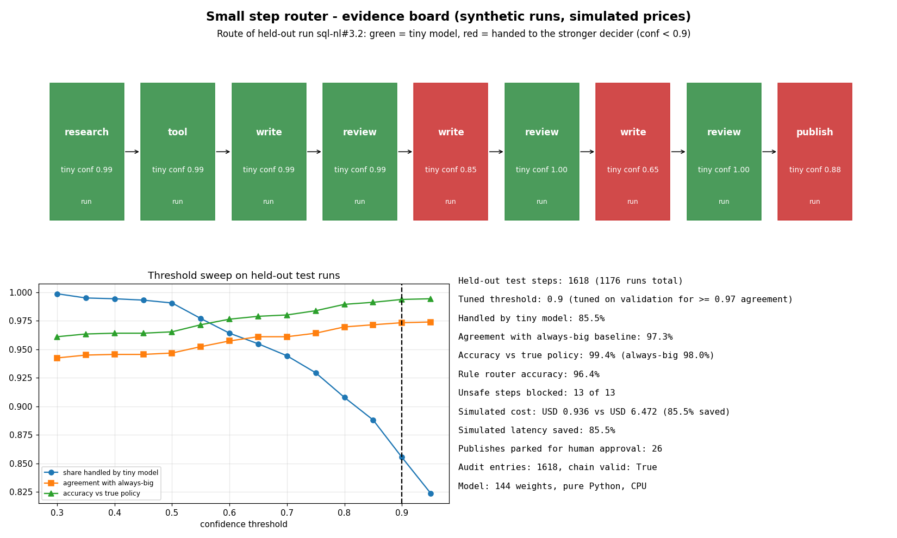
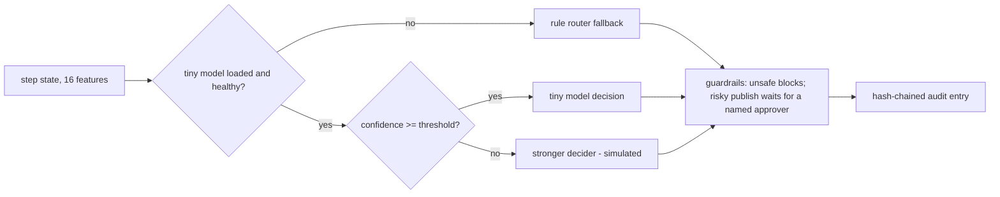

# Small step router: model card, results and limitations

A tiny classifier makes the routine call at every step of an agent run: which worker goes next (research, write, review, tool, publish), whether the step is safe to run, and whether the run should stop. When it is not confident, the step goes to a stronger deciding model. The stronger decider in this repo is **simulated**, and so are all prices and latencies. All runs are **synthetic**.



## Architecture



## Model card

| Field | Value |
|---|---|
| Model | Multinomial logistic regression with 3 heads (worker 5-way, safe 2-way, stop 2-way), pure Python, CPU |
| Size | 144 weights over 16 features |
| Confidence | product of the top probability of each head |
| Training data | Synthetic. Every eval case of all 22 agents is run through the governed runtime; each real run (status, tools used, approvals parked, tier, tokens) seeds step traces, widened by seeded perturbations (review quality, rework loops, a planted unsafe step in about 6% of runs) |
| Labels | A written step policy (`traces.oracle`) that also sees one hidden value: true draft quality. The router only sees it through a noisy review signal, so some steps are genuinely ambiguous |
| Split | By run, never by step: 60% train, 20% validation (threshold tuning), 20% held-out test |
| Intended use | Cheap, auditable step routing inside this repo's offline demo and as a reference pattern |
| Not for | Real routing decisions without retraining on your own logged runs and re-tuning the threshold |

## Measured on held-out test runs

From `results/router.json` (regenerated in CI, must match a fresh run):

| Metric | Value |
|---|---|
| States (train / validation / test) | 4,856 / 1,628 / 1,618 from 1,176 runs |
| Tuned threshold (highest tiny-model share with validation agreement >= 0.97) | 0.9 |
| Steps decided by the tiny model | 85.5% |
| Agreement with the always-big baseline (all three decisions match) | 97.3% |
| Accuracy against the true policy | 99.4% (always-big alone: 98.0%) |
| Rule router alone, accuracy against the true policy | 96.4% |
| Unsafe steps blocked | 13 of 13 |
| Simulated cost | USD 0.936 vs USD 6.472 always-big (85.5% saved) |
| Simulated latency saved | 85.5% |
| Publish steps parked for human approval | 26 |
| Audit entries / chain valid | 1,618 / true |

Threshold sweep on the test runs: at 0.30 the tiny model takes 99.9% of steps with 94.3% agreement; at 0.95 it takes 82.4% with 97.4% agreement. The chart on the board shows the full curve.

Why accuracy beats the baseline: the simulated stronger decider is wrong on a seeded 2% of steps, and the tiny model is right on most of those easy steps. Agreement with that baseline therefore tops out below 100% by design.

## Guardrails

- A publish step from an agent that owns risky tools is parked in the approval queue for a named person, whatever any decider says and however confident it is.
- An unsafe verdict from any source blocks the step.
- If the model is missing or raises, the rule router decides instead (`source = rule_fallback`), so a run never crashes on routing.
- Every decision, with its source, confidence and simulated cost, is appended to the hash-chained audit log; editing any entry breaks `verify()`.

## Limitations

- Everything is synthetic and the labels come from a policy we wrote, so the high scores show the pattern works, not that it would on real traffic.
- Prices and latencies are simulated round numbers, not quotes; savings scale with them directly.
- Savings equal the tiny-model share here because the tiny model is priced at zero; amortised hosting would lower them.
- Confidence is not calibrated (no reliability curve yet), and the threshold must be re-tuned when agents or prompts change.
- Linear model: it cannot learn interactions it is not given as features.

## Run it

```bash
python -m entagents.router.evaluate --out results/router.json
pip install -e ".[board]" && python scripts/router_board.py
pytest -q tests/test_router.py
```
